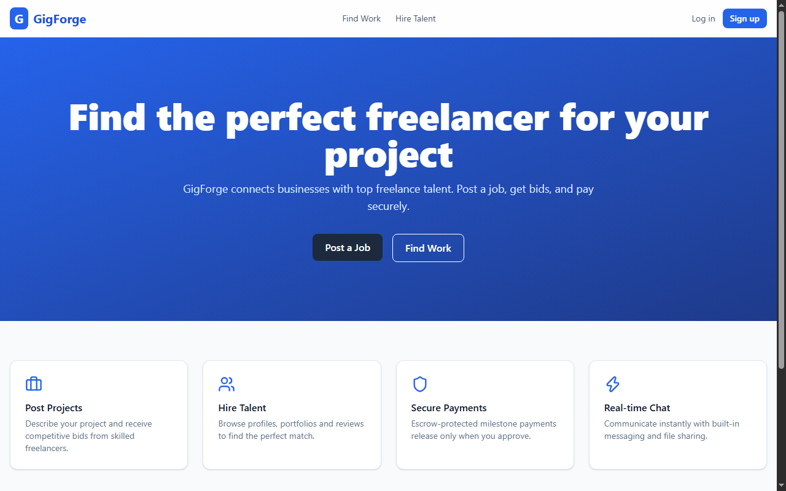
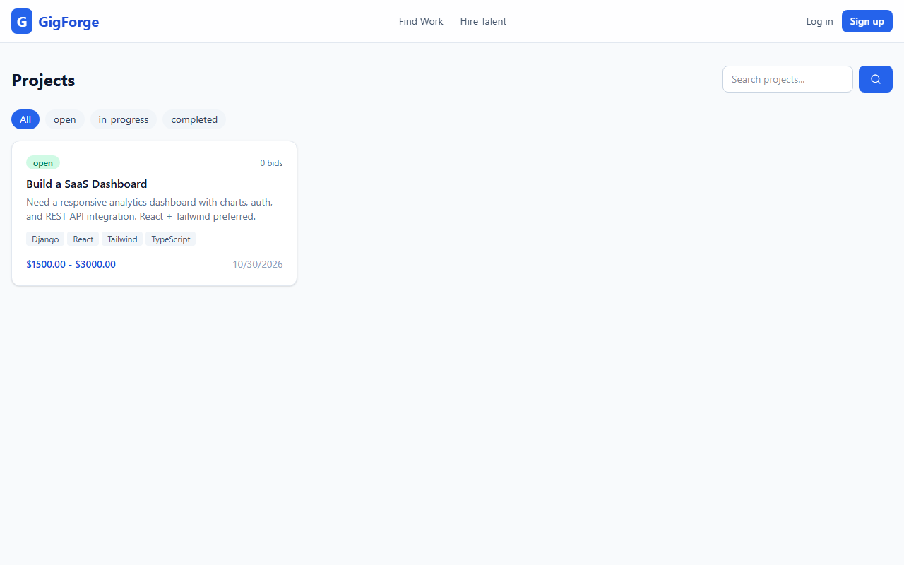
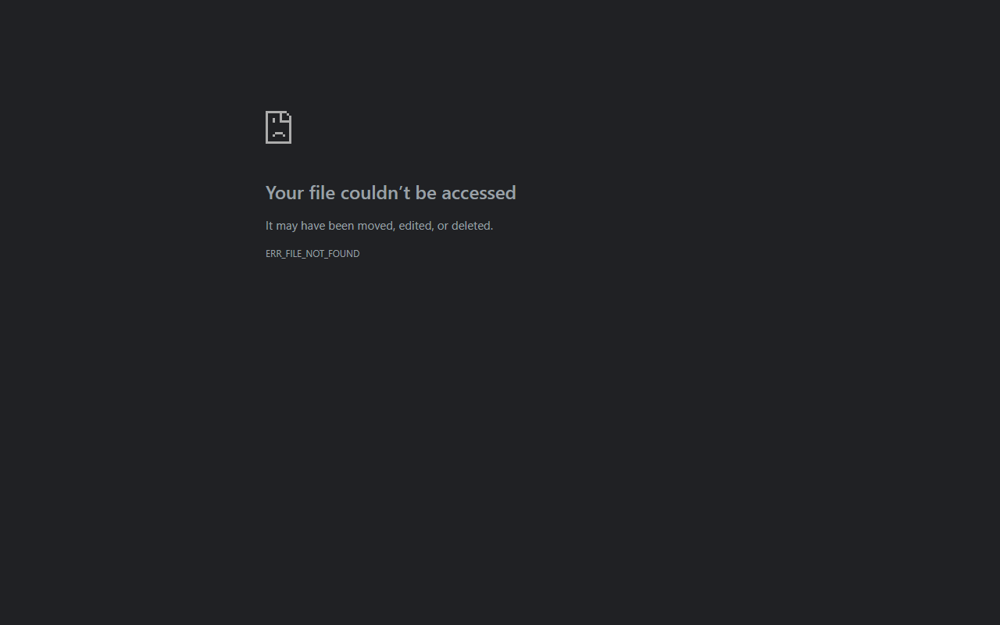

# GigForge — Freelance Marketplace Platform

A full-stack freelance marketplace (Upwork-style) built with **Django REST Framework**, **React**, and **MySQL**. Designed as a portfolio/resume project demonstrating production-grade full-stack engineering.

[](https://github.com/Imamirho3ein/freelance-marketplace/actions)

## ✨ Features

- **Multi-role auth** — Client, Freelancer, Admin with JWT (access + refresh, blacklisting)
- **Project lifecycle** — Post project → receive bids → accept bid → contract → milestones → payment → review
- **Advanced search** — Full-text search, filters (status, skill, budget), ordering, pagination
- **Real-time messaging** — WebSocket chat with file attachments (Django Channels + Redis)
- **Escrow-style payments** — Milestone-based release (Stripe-ready sandbox)
- **Reviews & ratings** — Aggregated freelancer ratings
- **Admin dashboard** — Platform analytics (users, projects, contracts, revenue)
- **File uploads** — Avatars, project attachments, chat files
- **API docs** — Auto-generated Swagger/OpenAPI (drf-spectacular)
- **Dockerized** — One-command setup with MySQL + Redis + Nginx

## 📸 Screenshots

| Home | Projects |
|---|---|
|  |  |

| Project Detail | Freelancers |
|---|---|
|  |  |

| Dashboard | Messages |
|---|---|
|  |  |

| Admin | API Docs |
|---|---|
|  |  |

## 🏗 Architecture

```
┌─────────────┐     REST/WS      ┌──────────────┐     ORM      ┌────────┐
│ React (Vite)│ ───────────────► │ Django + DRF │ ───────────► │ MySQL  │
│  Tailwind   │ ◄─────────────── │  Channels    │              │        │
└─────────────┘                  └──────┬───────┘              └────────┘
                                       │
                                       ▼
                                  ┌────────┐
                                  │ Redis  │ (cache + channel layer)
                                  └────────┘
```

## 🛠 Tech Stack

| Layer | Technology |
|---|---|
| Backend | Django 6, DRF, SimpleJWT, Django Channels, Daphne |
| Frontend | React 19, Vite, TypeScript, Tailwind CSS v4, React Query, Zustand |
| Database | MySQL 8 (InnoDB) |
| Cache/WS | Redis 7 |
| Auth | JWT (Bearer) + Google OAuth-ready |
| Payments | Stripe (sandbox) |
| Infra | Docker Compose, Nginx, GitHub Actions |
| Docs | drf-spectacular (Swagger) |

## 🚀 Quick Start

### With Docker (recommended)

```bash
git clone https://github.com/Imamirho3ein/freelance-marketplace.git
cd freelance-marketplace
cp .env.example .env
docker compose up --build
```

- Frontend: http://localhost:5173
- Backend API: http://localhost:8000/api/v1/
- Swagger: http://localhost:8000/api/v1/docs/

### Local development

**Backend**
```bash
cd backend
python -m venv .venv && source .venv/bin/activate   # Windows: .venv\Scripts\activate
pip install -r requirements.txt
cp ../.env.example .env
# set DB_ENGINE=django.db.backends.sqlite3 for local SQLite
python manage.py migrate
python manage.py createsuperuser
python manage.py runserver
```

**Frontend**
```bash
cd frontend
npm install
npm run dev
```

## 📁 Project Structure

```
freelance-marketplace/
├── backend/            # Django project
│   ├── config/         # settings, urls, asgi
│   ├── users/          # auth, profile, skills
│   ├── projects/       # project, bid, contract, milestone
│   ├── messaging/      # conversations, messages, websocket
│   ├── reviews/        # ratings
│   ├── notifications/  # in-app notifications
│   └── core/           # permissions, pagination, exceptions
├── frontend/           # React (Vite)
│   └── src/
│       ├── api/        # axios clients
│       ├── components/ # ui + layout
│       ├── pages/      # route pages
│       ├── store/      # zustand
│       └── types/
├── docker-compose.yml
├── .github/workflows/ci.yml
└── README.md
```

## 🔑 API Endpoints (selected)

| Method | Path | Description |
|---|---|---|
| POST | `/api/v1/users/register/` | Register |
| POST | `/api/v1/users/login/` | JWT login |
| GET | `/api/v1/users/me/` | Current user |
| GET/POST | `/api/v1/projects/` | List/create projects |
| GET | `/api/v1/projects/{id}/` | Project detail |
| POST | `/api/v1/projects/{id}/bids/` | Submit bid |
| POST | `/api/v1/projects/{id}/accept-bid/{bid_id}/` | Accept bid |
| GET/POST | `/api/v1/projects/contracts/` | Contracts |
| GET/POST | `/api/v1/messaging/conversations/` | Conversations |
| WS | `/ws/chat/{conversation_id}/` | Real-time chat |
| GET | `/api/v1/docs/` | Swagger UI |

## 🧪 Tests

```bash
cd backend
python manage.py test
```

Frontend build check:
```bash
cd frontend
npm run build
```

## 📄 License

MIT © 2026
